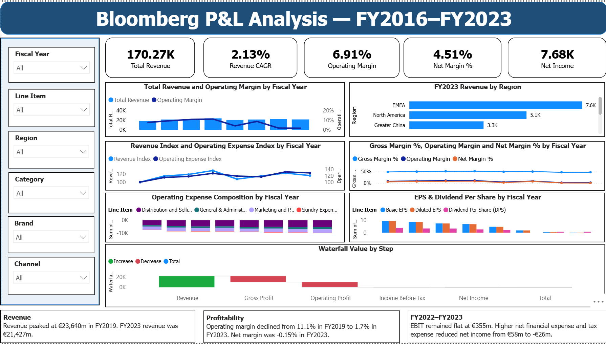

# 📊 Bloomberg P&L Data Extraction & Financial Analysis

[](https://www.python.org/)
[](https://pandas.pydata.org/)
[](https://powerbi.microsoft.com/)
[](https://www.microsoft.com/excel)

An end-to-end financial analytics, data transformation, and visualization project on Bloomberg-style P&L data for **ADS GY Equity** across **FY2016–FY2023**.

---

## 📌 Project Overview

This project demonstrates an end-to-end financial data analytics workflow using a Bloomberg-style financial data extract covering eight fiscal years (**FY2016 to FY2023**).

The project transforms a messy raw financial export into a structured, analysis-ready data layer, leveraging **Python, Excel, and Power BI** to analyze:

* 📈 **Revenue & Growth Performance**
* 💰 **Gross, Operating, & Net Profitability Trends**
* 📉 **Operating Expense (OpEx) Structure & Leverage**
* 🛍 **Revenue Segmentation** (Channel, Product Category, & Brand)
* 🌍 **Comparable Regional Revenue Performance**
* 📊 **EPS & Dividend Share Trends**
* ⚠️ **FY2022–FY2023 Performance Compression Analysis**

> **Note:** This project utilizes synthetic training data engineered to mirror Bloomberg-style financial extracts. Figures are used for analytical demonstration and portfolio purposes.

---

## 🎯 Key Objectives

1. **Audit & Standardize:** Preprocess messy, multi-header raw financial extracts.
2. **Automate ETL:** Use Python (`Pandas`, `NumPy`) to clean, handle unit anomalies, convert currency formatting, and unpivot/reshape financial statements.
3. **Financial Modeling:** Build a dynamic, lookup-driven financial analysis workbook in Microsoft Excel.
4. **Interactive BI:** Built an executive Power BI dashboard using DAX measures, KPI cards, interactive slicers and financial visuals.
5. **Strategic Insights:** Derive CFO-level recommendations on operating leverage, gross margin protection, and channel expansion.

---

## 🛠️ Tools & Tech Stack

| Category | Tool / Technology | Primary Application |
| :--- | :--- | :--- |
| **Data Processing** | `Python` • `Pandas` • `NumPy` | Preprocessing, cleaning, unpivoting, unit reconciliation |
| **Spreadsheet Modeling** | `Microsoft Excel` • `openpyxl` | Master P&L, indexed trend analysis, financial ratios |
| **Business Intelligence** | `Power BI` • `DAX` | Interactive executive dashboards, KPI cards, waterfall charts |
| **Documentation** | `Markdown` • `PDF Report` | Executive CFO summary & management reports |

---

## 📂 Project Structure

```text
Bloomberg_P&L_Data_Analysis/
│
├── 📂 data/
│   ├── raw/                  # Original raw financial exports
│   └── cleaned/              # Structured, analysis-ready CSVs
│
├── 📂 notebook/
│   └── Bloomberg_P&L_Analysis.ipynb  # Data cleaning & validation script
│
├── 📂 excel/
│   └── Bloomberg_P&L_Analysis.xlsx   # Financial model & lookup tables
│
├── 📂 powerbi/
│   └── Bloomberg_P&L_Dashboard.pbix  # Interactive Power BI report
│
├── 📂 report/
│   └── Bloomberg_P&L_Analysis_Report_FY2016_FY2023.pdf
│
├── 📂 screenshots/           # Dashboard previews & visual assets
└── 📜 README.md

```

### 🔄 Data Cleaning & Preprocessing (Python)

Financial exports from terminals like Bloomberg often contain multi-line headers, parenthetical negatives, and unit variations.

```python
# Sample snippet: Standardizing parenthetical negatives & unit anomalies
import pandas as pd
import numpy as np

def clean_financial_value(val):
    if pd.isna(val) or val in ['NM', '—', '-']:
        return np.nan
    if isinstance(val, str):
        val = val.strip().replace(',', '')
        if val.startswith('(') and val.endswith(')'):
            return -float(val[1:-1])
    return float(val)

# Reconciling unit inconsistency in FY2018 Other Businesses
# Raw: 986,000 -> Standardized to €986M to align with regional sub-totals
df.loc[(df['Year'] == 2018) & (df['Segment'] == 'Other Businesses'), 'Revenue'] = 986.0
```

### Key Data Engineering Steps:
* **Unit Reconciliation:** Identified and resolved an inline scale anomaly in FY2018 (*Other Businesses* converted from `986,000` to `€986M`).
* **Format Normalization:** Standardized parenthetical text values `(123)` to numeric negative values `-123.0`.
* **Structural Reshaping:** Reshaped wide financial statements into a tidy, normalized database format.

---

## 📊 Key Financial Findings

### 1. Top-Line Growth vs. Profitability Squeeze
* **Revenue Path:** Rose from **€18,483M (FY2016)** to a peak of **€23,640M (FY2019)**, settling at **€21,427M (FY2023)** (2.13% CAGR).
* **Margin Compression:** While top-line revenue grew +15.9% overall, net profitability eroded rapidly post-FY2019 due to margin degradation and rising OpEx.

| Metric | FY2016 | FY2019 (Peak) | FY2023 | Trend / Variance |
| :--- | :---: | :---: | :---: | :---: |
| **Gross Margin** | 48.6% | **52.0%** | **47.5%** | 📉 -450 bps vs Peak |
| **Operating Margin** | 7.6% | **11.1%** | **1.7%** | 📉 -940 bps vs Peak |
| **Net Margin** | 5.13% | **7.8%** | **-0.15%** | 🔻 Negative Net Income |
| **Basic EPS** | €5.10 | **€9.48** | **-€0.18** | 📉 Earnings Compression |

---

### 2. Operational Expense (OpEx) Intensity
The sharp decline in operating margin was primarily driven by increasing cost intensity in **Distribution & Selling Expenses**:
* **Distribution & Selling:** Surged from **21.8% of revenue** (FY2016) to **25.8% of revenue** (FY2023) — a **+400 bps increase**.
* **Total OpEx Ratio:** Escalated from **41.9%** to **46.6%** of total revenue, severely weakening operational leverage.

---

### 3. Channel Shift: Direct-to-Consumer (DTC) Expansion
Retail channels outpaced traditional wholesale distribution over the 8-year period:
* **Retail (DTC):** Grew **+66.2%** (from €5,841M to €9,706M), expanding total revenue share from **31.6% ➔ 45.3%**.
* **Wholesale:** Contracted by **~4.5%**, dropping from **63.1% ➔ 52.0%** of total revenue share.

---

### 4. Regional Performance Highlights
Using comparable regional mapping across historical segment changes:
* 🏆 **Top Regional Growth:** **North America** (+67.6% growth, expanding from €3,068M to €5,142M).
* 🌏 **Other Regions:** **Latin America** (+25.0%), **Asia-Pacific** (+15.9%), **Greater China** (+9.4%), **EMEA** (+2.6%).

---

## 📈 Executive Power BI Dashboard

The interactive Power BI dashboard provides dynamic visual analytics across financial dimensions:



### Key Dashboard Modules:
1. **Executive KPI Cards:** Total Revenue, CAGR, Operating Margin, Net Profit, and EPS.
2. **Profitability Waterfalls:** Visual breakdown from Gross Revenue down to Net Income.
3. **OpEx Cost Structure:** Indexed trend line analysis comparing OpEx growth against top-line growth.
4. **Channel & Geographic Mix:** Regional revenue analysis with interactive filtering across geographic and business dimensions.

---

## 💡 Strategic CFO Recommendations

1. ⚙️ **Re-establish Operating Leverage:** Address rising distribution/selling cost intensity (+400 bps) through supply chain efficiency programs.
2. 🛡️ **Gross Margin Stabilization:** Rebuild pricing power and discount discipline to target historical gross margin levels (~50%+).
3. 🛍️ **DTC Channel Profitability:** Evaluate unit economics in retail expansion to ensure higher retail revenue translates directly to net earnings.
4. 💵 **Below-the-Line Expense Management:** Mitigate rising net financial and interest expenses that contributed to negative FY2023 net income.

---

## 📋 Quick Reference Q&A

| Metric / Question | Analytical Output |
| :--- | :--- |
| **Peak Revenue Year** | **FY2019** (€23,640M) |
| **Highest Gross Margin** | **FY2019** (52.0%) |
| **Lowest Gross Margin** | **FY2022** (47.3%) |
| **Fastest Growing Channel** | **Retail** (+66.2% total growth) |
| **Top Regional Performer** | **North America** (+67.6% growth) |
| **Lowest Basic EPS** | **FY2023** (-€0.18) |

---

## ⚠️ Disclaimer

This repository is built for **educational and portfolio demonstration purposes** using synthetic training data designed to simulate Bloomberg terminal financial data exports. Findings should not be interpreted as official financial reports or commercial financial advice.

---

### 👨‍💻 Created & Maintained by
**Anurag Tyagi** — *Data Analyst*
* 🔗 [LinkedIn](https://www.linkedin.com/in/anurag-tyagi-634a5a36b)
* 📁 [GitHub Portfolio](https://github.com/tyagi-4080)
